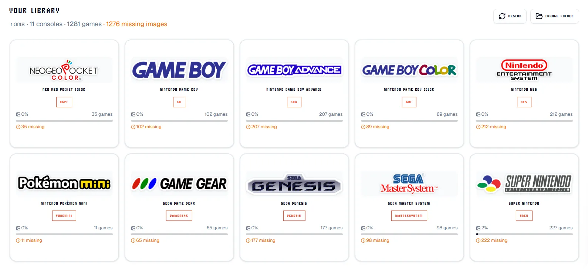

<div align="center">
  
</div>

# ES Media Manager

Manage game covers, logos, screenshots and videos on a retro handheld's SD card, straight from the browser. No uploads, no accounts.

Built for ArkOS, ROCKNIX, JELOS and other EmulationStation firmware (R36S, RG35XX, RG503…).

## Run

```bash
bun install
cp .env.example .env.local   # add your ScreenScraper.fr developer credentials
bun run dev
```

MIT
